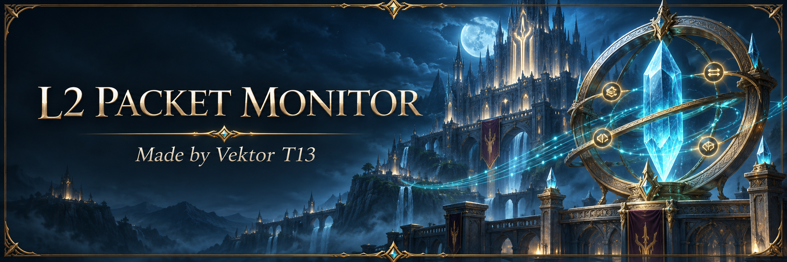
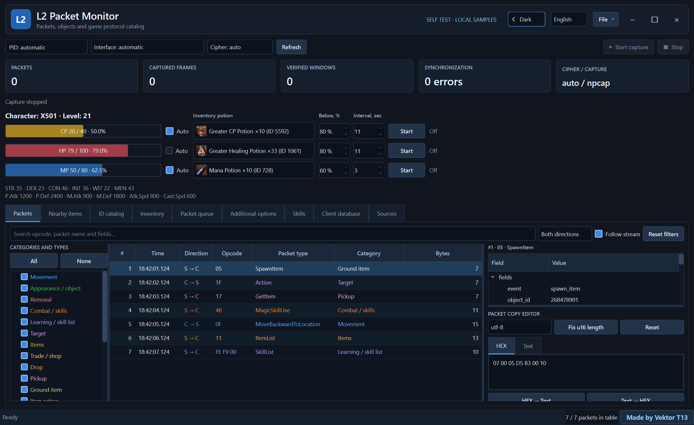
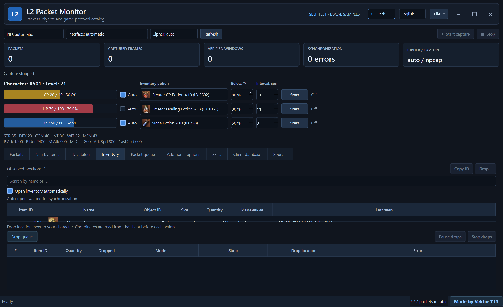
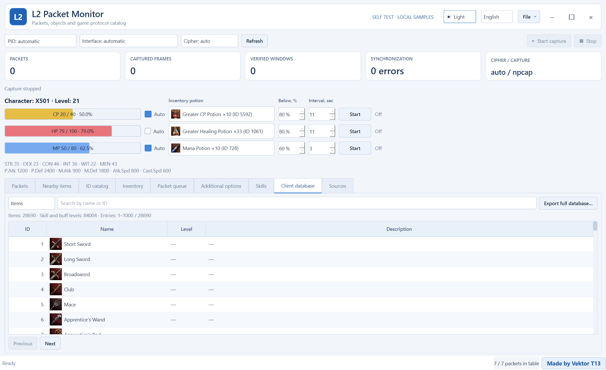
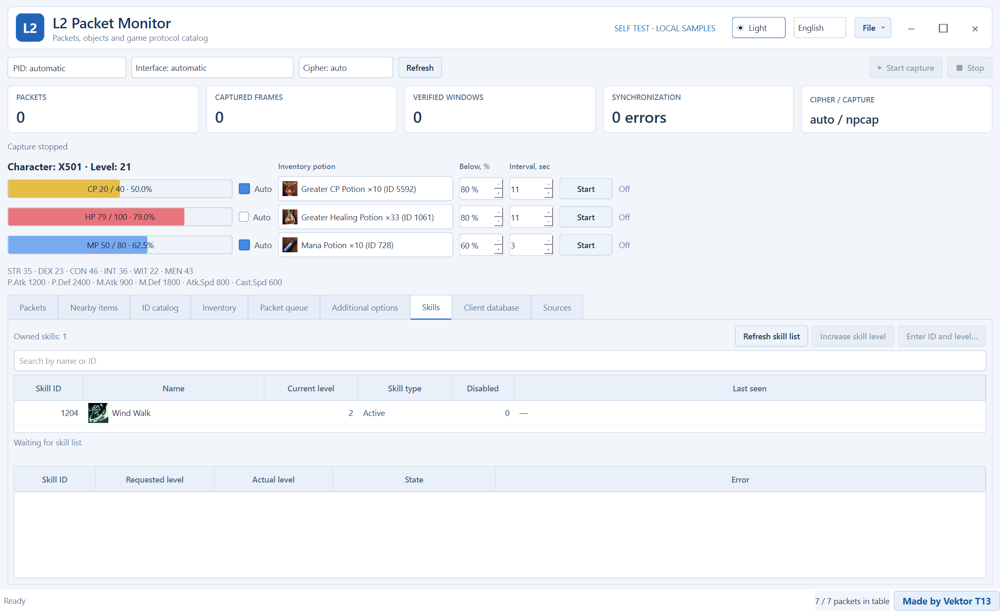
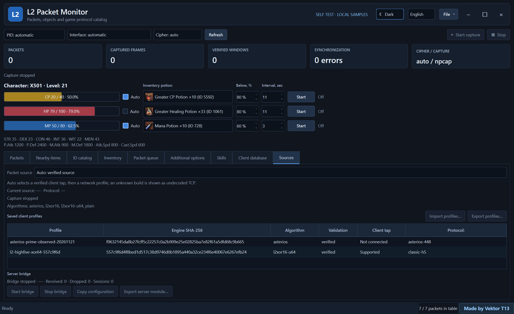
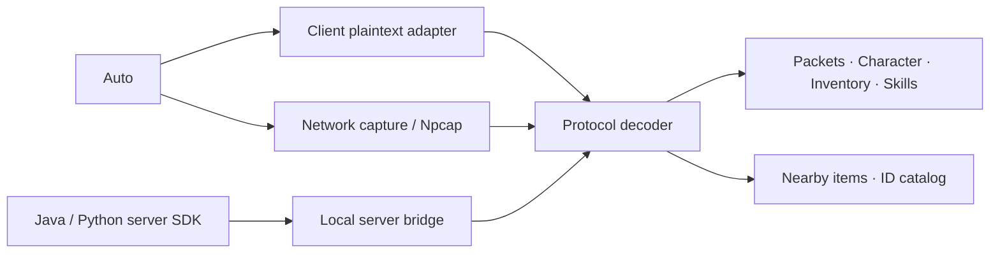

<p align="center"></p>

<p align="center"><strong>Lineage II packets, character state and client tools in one native Windows application.</strong></p>

<p align="center">
  <a href="https://github.com/vektort13/L2PacketMonitor/releases/latest"></a>
  
  
  
</p>

<p align="center">
  <b>English</b> · <a href="README.ru.md">Русский</a><br>
  <a href="https://github.com/vektort13/L2PacketMonitor/releases/latest">Download</a> ·
  <a href="docs/guides/USER_GUIDE.en.md">User guide</a> · <a href="docs/guides/USER_GUIDE.ru.md">Руководство</a> ·
  <a href="docs/BUILD.en.md">Build from source</a> · <a href="docs/GALLERY.md">Gallery</a>
</p>

## See the exchange. Follow the character.

**L2 Packet Monitor** combines live packet capture, decoding, a HEX/text editor, inventory, skills, nearby items and outgoing packet queues. Its Qt interface includes Russian and English, dark and light themes, and a character panel with independent CP, HP and MP recovery controls.

The ready-to-run EXE contains Python, Qt, client icons, the item/skill database, protocol tables and native adapters. Network capture uses the separately installed [Npcap driver](https://npcap.com/#download).

<a href="docs/images/packets-en-dark.png"></a>

## What you can do

| | Feature | In the application |
|:--:|---|---|
| ◈ | **Live packets** | C → S and S → C, category/opcode filters, search, HEX and decoded fields. |
| ✦ | **Packet sources** | Auto selection, network capture, client plaintext adapter, Java/Python server bridge. |
| ▣ | **Character panel** | Name, level, attributes, CP/HP/MP; separate potion, threshold and interval for each resource. |
| ⚒ | **Inventory & skills** | Named items with icons, quantities, observed skill levels, refresh and supported learning actions. |
| ⟳ | **Packet queues** | Edit copies, reorder, set cycles and delay, export JSON, start, pause, resume and stop. |
| ✧ | **Nearby items** | Track appearances and pickups, run supported drop queues and automatic pickup. |
| ▤ | **Client database** | **28,690 items**, **84,004 skill/buff level records**, **4,751 icon images**, offline search and JSON export. |
| ⌘ | **Integration** | Optional loopback JSON API, transferable profiles and server plaintext SDK. |

## Start in three steps

1. Download **[L2PacketMonitor.exe](https://github.com/vektort13/L2PacketMonitor/releases/latest/download/L2PacketMonitor.exe)** or the portable ZIP from [Releases](https://github.com/vektort13/L2PacketMonitor/releases/latest). Install [Npcap](https://npcap.com/#download) for network capture if needed.
2. Open the EXE, launch the game and enter the world. Keep **PID**, **Interface** and **Cipher** on automatic selection and **Sources → Auto** for the first connection.
3. Check the source/status line, then open **Packets**, **Inventory**, **Skills** or **Client database**. The CP/HP/MP panel sits above the tabs.

Network mode discovers `l2.exe` / `AsteriosGame.exe`, their actual TCP connection and the matching adapter, including loopback. The default network interval is four seconds. Client plaintext mode receives packets directly from the supported adapter.

**[Full English guide →](docs/guides/USER_GUIDE.en.md)** · **[Полное руководство на русском →](docs/guides/USER_GUIDE.ru.md)**

## A window for every workflow

<table>
  <tr>
    <td width="50%"><a href="docs/images/inventory-en-dark.png"></a><br><b>Inventory &amp; original icons</b></td>
    <td width="50%"><a href="docs/images/catalog-en-light.png"></a><br><b>Client database &amp; light theme</b></td>
  </tr>
  <tr>
    <td><a href="docs/images/skills-en-light.png"></a><br><b>Skills &amp; level progression</b></td>
    <td><a href="docs/images/sources-en-dark.png"></a><br><b>Sources &amp; saved profiles</b></td>
  </tr>
</table>

The [gallery](docs/GALLERY.md) contains all nine tabs in both languages and both themes.

## Sources and client profiles



| Saved build | Protocol | Capture paths |
|---|---|---|
| Engine SHA-256 `557c9f6d…` | `classic-h5` | Client plaintext adapter and `l2xor16-u64` network profile |
| Engine SHA-256 `f9632145…` | `asterios-448` | Asterios network profile with native-equivalent decoding |
| Other builds | Raw TCP / bridge protocol | Raw network capture, or the protocol supplied by an integrated server SDK |

The **Sources** tab shows full fingerprints and adapter availability. Decoding and game actions are selected for the matching build; their availability is shown in the window. Profile ZIP import/export preserves the saved algorithms. Details: [profile registry](docs/cipher-profiles.md), [unified sources](docs/unified-sources.md), [server SDK](src/server_bridge_sdk/README.md).

## Build and develop

On Windows x64, install Python 3.12 and the Visual Studio C++ desktop tools, then:

```powershell
git clone https://github.com/vektort13/L2PacketMonitor.git
cd L2PacketMonitor
py -3.12 -m venv .venv
.\.venv\Scripts\python.exe -m pip install -r requirements-dev.txt
.\.venv\Scripts\python.exe packaging\build.py --dist-dir dist
```

The build compiles x86 client helpers, packages the EXE and runs its UI/native self-test. Start from source with `.\.venv\Scripts\python.exe src\desktop.py`.

**[Build instructions: English](docs/BUILD.en.md)** · **[Сборка: русский](docs/BUILD.ru.md)**

## Included resources

| Path | Contents |
|---|---|
| [`src/l2_monitor/`](src/l2_monitor/) | Desktop UI, capture, decoders, models, queues and API |
| [`src/native_probe/`](src/native_probe/) | Native client adapter and action bridge sources |
| [`src/server_bridge_sdk/`](src/server_bridge_sdk/) | Java and Python server adapters |
| [`config/`](config/) | Both profiles, cipher registry, opcodes and complete client catalog |
| [`assets/client-icons.zip`](assets/client-icons.zip) | Client icons and lookup manifest |
| [`packaging/`](packaging/) | Build scripts, EXE icon and Windows version information |
| [`tests/`](tests/) | Logic tests, protocol fixtures and adapter tests |
| [`docs/`](docs/) | RU/EN guides, screenshots, technical notes and verification |
| [`web/`](web/) | Browser interface used during development |

The [resource manifest](docs/RESOURCES.md) lists packaged assets and checksums. [Releases](https://github.com/vektort13/L2PacketMonitor/releases) contain the EXE, portable archive and complete source/resource bundle.

<p align="center"></p>
<p align="center"><strong>Made by Vektor T13</strong></p>
