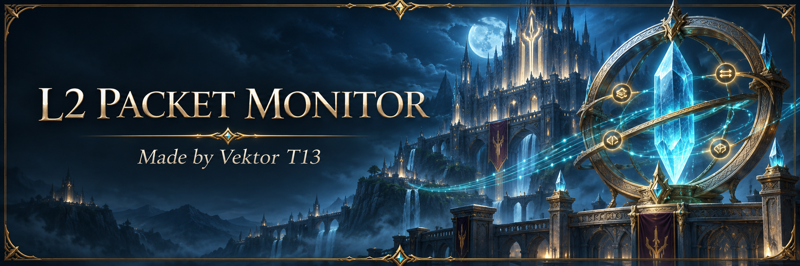
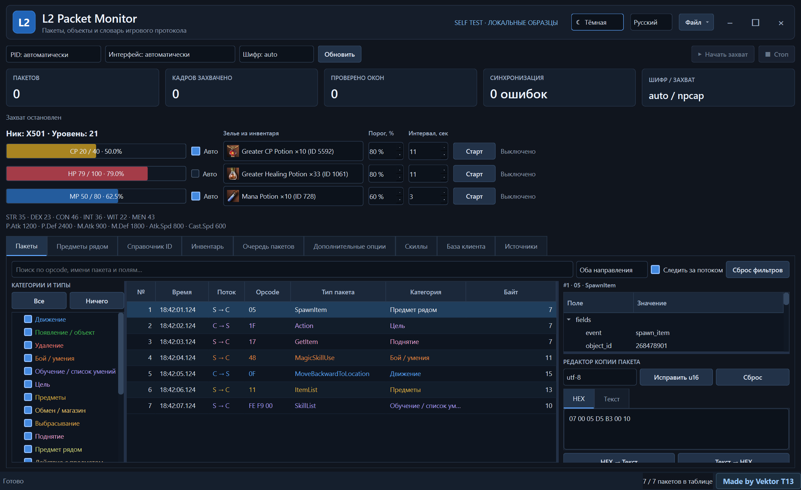
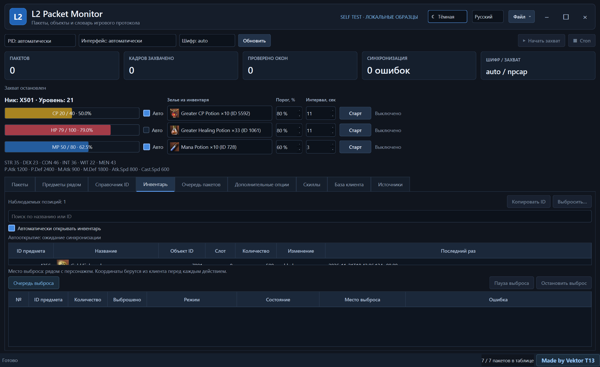
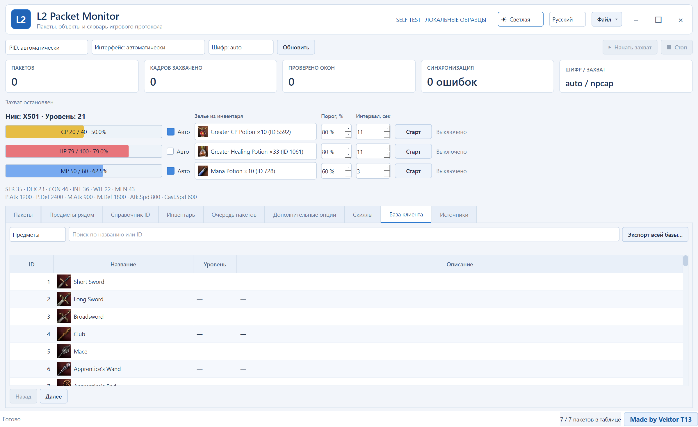
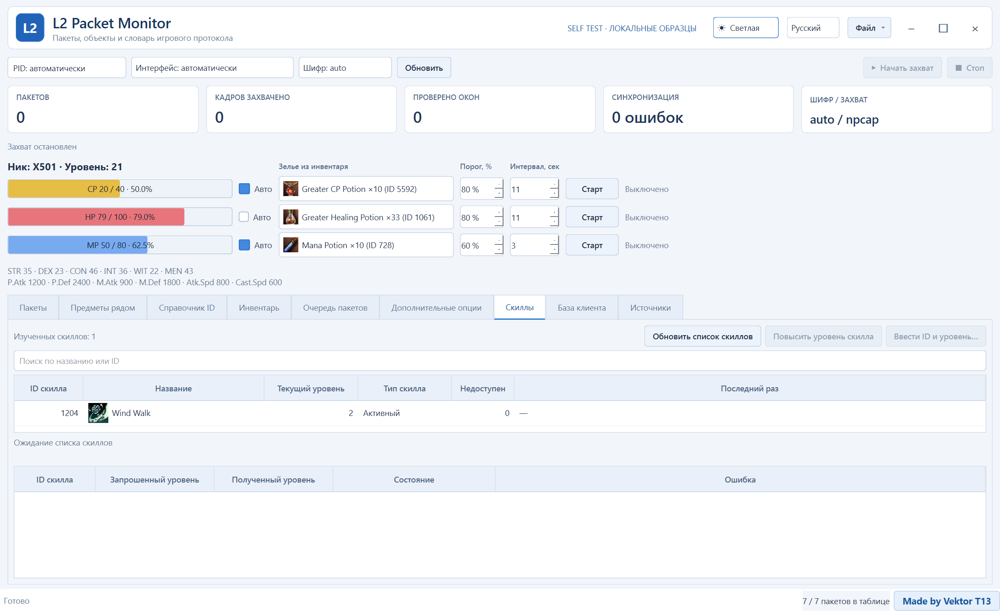
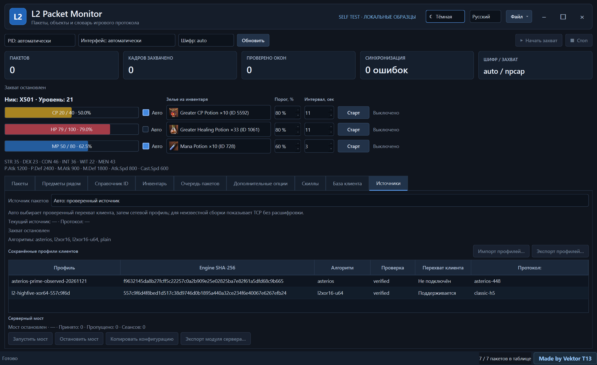
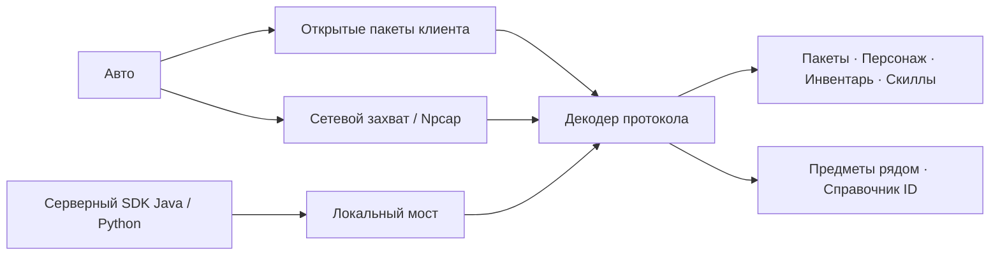

<p align="center"></p>

<p align="center"><strong>Пакеты Lineage II, состояние персонажа и инструменты клиента в одном Windows-приложении.</strong></p>

<p align="center">
  <a href="https://github.com/vektort13/L2PacketMonitor/releases/latest"></a>
  
  
  
</p>

<p align="center">
  <a href="README.md">English</a> · <b>Русский</b><br>
  <a href="https://github.com/vektort13/L2PacketMonitor/releases/latest">Скачать</a> ·
  <a href="docs/guides/USER_GUIDE.ru.md">Руководство</a> · <a href="docs/guides/USER_GUIDE.en.md">English guide</a> ·
  <a href="docs/BUILD.ru.md">Сборка из исходников</a> · <a href="docs/GALLERY.md">Галерея</a>
</p>

## Весь обмен и состояние персонажа перед глазами

**L2 Packet Monitor** объединяет захват и расшифровку пакетов, редактор HEX/текста, инвентарь, скиллы, предметы рядом и очереди исходящих пакетов. Нативный интерфейс Qt поддерживает русский и английский языки, тёмную и светлую темы. Над вкладками расположена панель персонажа с отдельным восстановлением CP, HP и MP.

Готовый EXE содержит Python, Qt, иконки клиента, базу предметов и умений, таблицы протокола и нативные адаптеры. Для сетевого захвата используется отдельно установленный [драйвер Npcap](https://npcap.com/#download).

<a href="docs/images/packets-ru-dark.png"></a>

## Возможности

| | Функция | Что доступно |
|:--:|---|---|
| ◈ | **Пакеты в реальном времени** | C → S и S → C, категории, opcode, поиск, HEX и разобранные значения. |
| ✦ | **Выбор источника** | Автовыбор, сеть, открытые пакеты клиента и серверный мост Java/Python. |
| ▣ | **Панель персонажа** | Ник, уровень, характеристики, CP/HP/MP; отдельные зелья, пороги и интервалы. |
| ⚒ | **Инвентарь и скиллы** | Названия, иконки и количество предметов, уровни умений, обновление списков и поддерживаемое обучение. |
| ⟳ | **Очереди пакетов** | Редактирование копий, порядок, циклы, интервал, экспорт JSON, запуск, пауза и остановка. |
| ✧ | **Предметы рядом** | Наблюдение за появлением и подбором, поддерживаемые очереди выброса и автоподбор. |
| ▤ | **База клиента** | **28 690 предметов**, **84 004 записи скиллов/бафов по уровням**, **4 751 изображение иконок**, поиск без игры и экспорт JSON. |
| ⌘ | **Интеграция** | Локальный JSON API, перенос профилей и SDK открытых пакетов сервера. |

## Первый запуск — три шага

1. Скачайте **[L2PacketMonitor.exe](https://github.com/vektort13/L2PacketMonitor/releases/latest/download/L2PacketMonitor.exe)** или переносимый ZIP из [Releases](https://github.com/vektort13/L2PacketMonitor/releases/latest). Для сетевого захвата при необходимости установите [Npcap](https://npcap.com/#download).
2. Откройте EXE, запустите игру и войдите в мир. Оставьте **PID**, **интерфейс** и **шифр** на автоматическом выборе, а на вкладке **«Источники»** выберите **«Авто»**.
3. Проверьте строку состояния и текущий источник. Откройте **«Пакеты»**, **«Инвентарь»**, **«Скиллы»** или **«Базу клиента»**. Панель CP/HP/MP находится над вкладками.

В сетевом режиме программа находит `l2.exe` / `AsteriosGame.exe`, реальное TCP-соединение и нужный адаптер, включая loopback. Интервал сетевого захвата по умолчанию — четыре секунды. Клиентский источник получает открытые пакеты от поддерживаемого адаптера.

**[Полное руководство на русском →](docs/guides/USER_GUIDE.ru.md)** · **[Full English guide →](docs/guides/USER_GUIDE.en.md)**

## Интерфейс для разных задач

<table>
  <tr>
    <td width="50%"><a href="docs/images/inventory-ru-dark.png"></a><br><b>Инвентарь и оригинальные иконки</b></td>
    <td width="50%"><a href="docs/images/catalog-ru-light.png"></a><br><b>База клиента и светлая тема</b></td>
  </tr>
  <tr>
    <td><a href="docs/images/skills-ru-light.png"></a><br><b>Умения и повышение уровней</b></td>
    <td><a href="docs/images/sources-ru-dark.png"></a><br><b>Источники и профили</b></td>
  </tr>
</table>

В [галерее](docs/GALLERY.md) собраны все девять вкладок на двух языках и в обеих темах.

## Источники и профили клиентов



| Сохранённая сборка | Протокол | Источники |
|---|---|---|
| Engine SHA-256 `557c9f6d…` | `classic-h5` | Адаптер клиента и сетевой профиль `l2xor16-u64` |
| Engine SHA-256 `f9632145…` | `asterios-448` | Сетевой профиль Asterios с проверенной эквивалентностью нативной расшифровки |
| Другие сборки | Raw TCP / протокол моста | Сетевые TCP-данные или протокол подключённого серверного SDK |

Полные отпечатки сборок и наличие адаптера показаны на вкладке **«Источники»**. Расшифровка и игровые действия выбираются для соответствующей сборки; доступность видна в окне. Импорт и экспорт ZIP позволяют переносить профили с сохранёнными алгоритмами. Подробнее: [реестр](docs/cipher-profiles.md), [единые источники](docs/unified-sources.md), [серверный SDK](src/server_bridge_sdk/README.md).

## Сборка и разработка

В Windows x64 установите Python 3.12 и компоненты Visual Studio для разработки классических приложений на C++, затем выполните:

```powershell
git clone https://github.com/vektort13/L2PacketMonitor.git
cd L2PacketMonitor
py -3.12 -m venv .venv
.\.venv\Scripts\python.exe -m pip install -r requirements-dev.txt
.\.venv\Scripts\python.exe packaging\build.py --dist-dir dist
```

Сборка компилирует клиентские x86-модули, упаковывает EXE и запускает встроенную проверку интерфейса и адаптеров. Запуск из исходников: `.\.venv\Scripts\python.exe src\desktop.py`.

**[Подробная инструкция по сборке](docs/BUILD.ru.md)** · **[Build instructions in English](docs/BUILD.en.md)**

## Ресурсы в репозитории

| Путь | Содержимое |
|---|---|
| [`src/l2_monitor/`](src/l2_monitor/) | Интерфейс, захват, декодеры, модели, очереди и API |
| [`src/native_probe/`](src/native_probe/) | Исходники клиентского адаптера и моста действий |
| [`src/server_bridge_sdk/`](src/server_bridge_sdk/) | Серверные адаптеры Java и Python |
| [`config/`](config/) | Оба профиля, реестр шифров, opcode и полная база клиента |
| [`assets/client-icons.zip`](assets/client-icons.zip) | Иконки клиента и манифест сопоставления |
| [`packaging/`](packaging/) | Скрипты сборки, иконка EXE и сведения о версии |
| [`tests/`](tests/) | Автотесты, примеры протокола и проверки адаптеров |
| [`docs/`](docs/) | Руководства RU/EN, скриншоты, технические материалы и результаты проверок |
| [`web/`](web/) | Браузерный интерфейс для разработки |

[Манифест ресурсов](docs/RESOURCES.md) содержит список встроенных файлов и контрольные суммы. В [Releases](https://github.com/vektort13/L2PacketMonitor/releases) доступны EXE, переносимый архив и полный комплект исходников с ресурсами.

<p align="center"></p>
<p align="center"><strong>Made by Vektor T13</strong></p>
