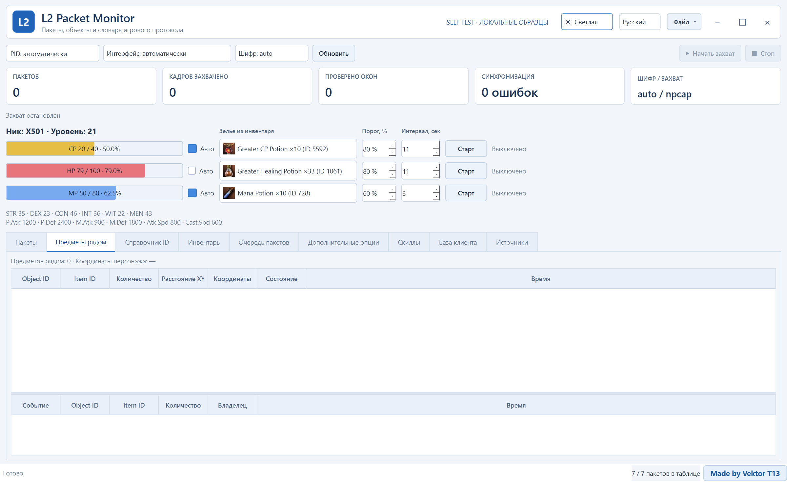
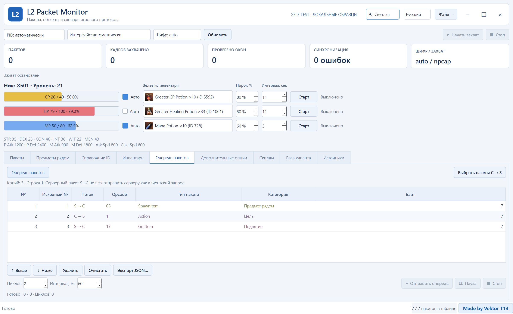
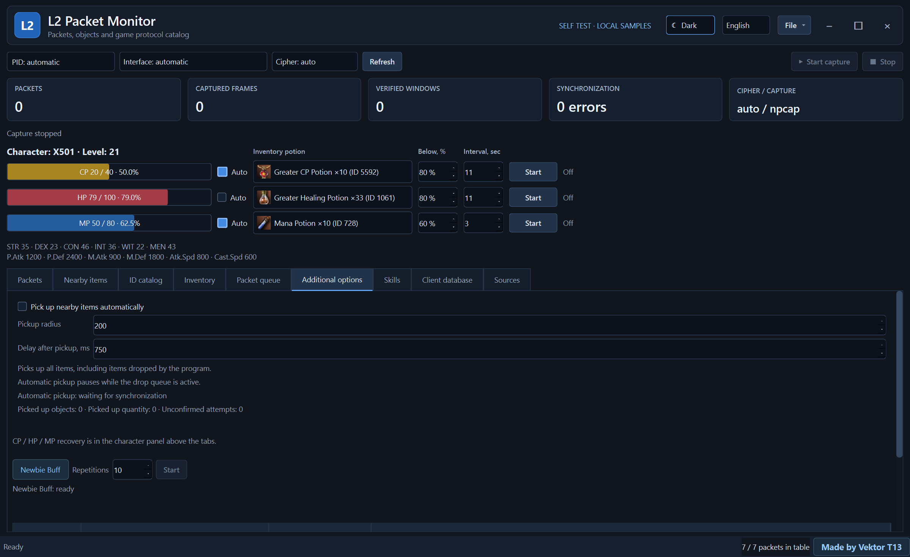
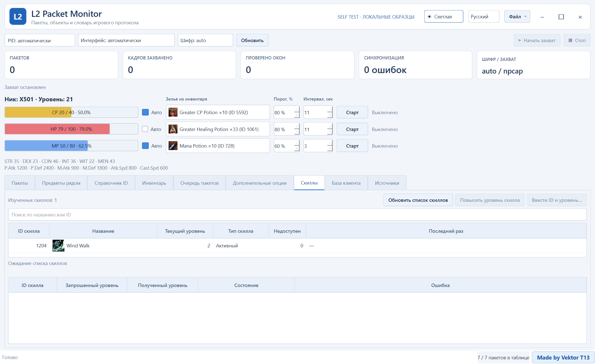
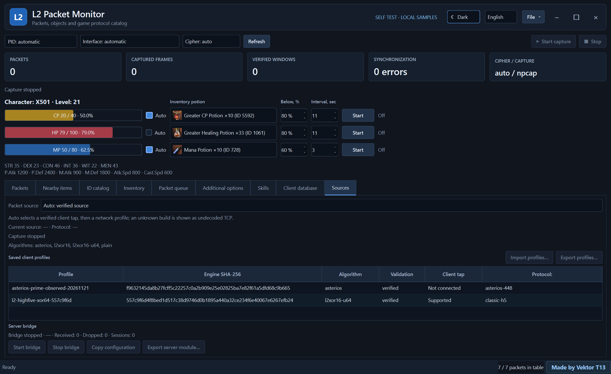

# Interface gallery / Галерея интерфейса

[Home](../README.md) · [Главная](../README.ru.md) · [English guide](guides/USER_GUIDE.en.md) · [Русское руководство](guides/USER_GUIDE.ru.md)

Nine tabs × two languages × two themes. Click a screenshot to open the full-size image.

Девять вкладок × два языка × две темы. Нажмите изображение, чтобы открыть полный размер.

## Packets / Пакеты

| English · Dark | Русский · Светлая |
|---|---|
|  |  |

[English light](images/packets-en-light.png) · [Русский тёмная](images/packets-ru-dark.png)

## Nearby items / Предметы рядом

| English · Dark | Русский · Светлая |
|---|---|
|  |  |

[English light](images/world-en-light.png) · [Русский тёмная](images/world-ru-dark.png)

## ID catalog / Справочник ID

| English · Dark | Русский · Светлая |
|---|---|
|  |  |

[English light](images/library-en-light.png) · [Русский тёмная](images/library-ru-dark.png)

## Inventory / Инвентарь

| English · Dark | Русский · Светлая |
|---|---|
|  |  |

[English light](images/inventory-en-light.png) · [Русский тёмная](images/inventory-ru-dark.png)

## Packet queue / Очередь пакетов

| English · Dark | Русский · Светлая |
|---|---|
|  |  |

[English light](images/queue-en-light.png) · [Русский тёмная](images/queue-ru-dark.png)

## Additional options / Дополнительные опции

| English · Dark | Русский · Светлая |
|---|---|
|  |  |

[English light](images/options-en-light.png) · [Русский тёмная](images/options-ru-dark.png)

## Skills / Скиллы

| English · Dark | Русский · Светлая |
|---|---|
|  |  |

[English light](images/skills-en-light.png) · [Русский тёмная](images/skills-ru-dark.png)

## Client database / База клиента

| English · Dark | Русский · Светлая |
|---|---|
|  |  |

[English light](images/catalog-en-light.png) · [Русский тёмная](images/catalog-ru-dark.png)

## Sources / Источники

| English · Dark | Русский · Светлая |
|---|---|
|  |  |

[English light](images/sources-en-light.png) · [Русский тёмная](images/sources-ru-dark.png)

