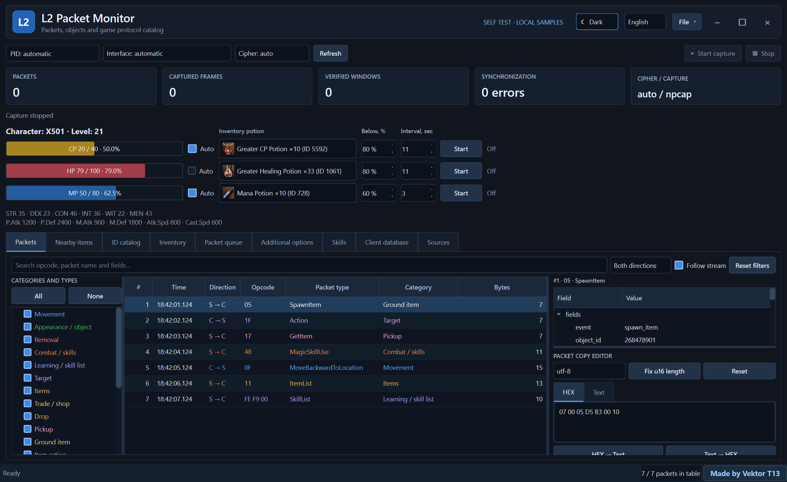
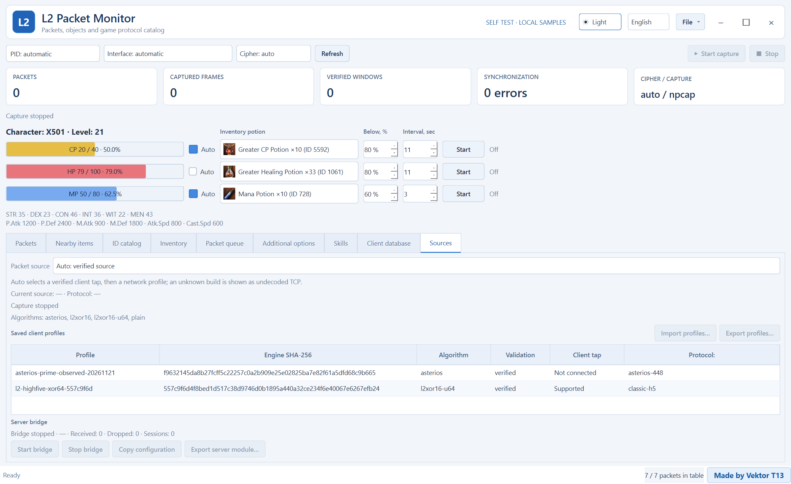
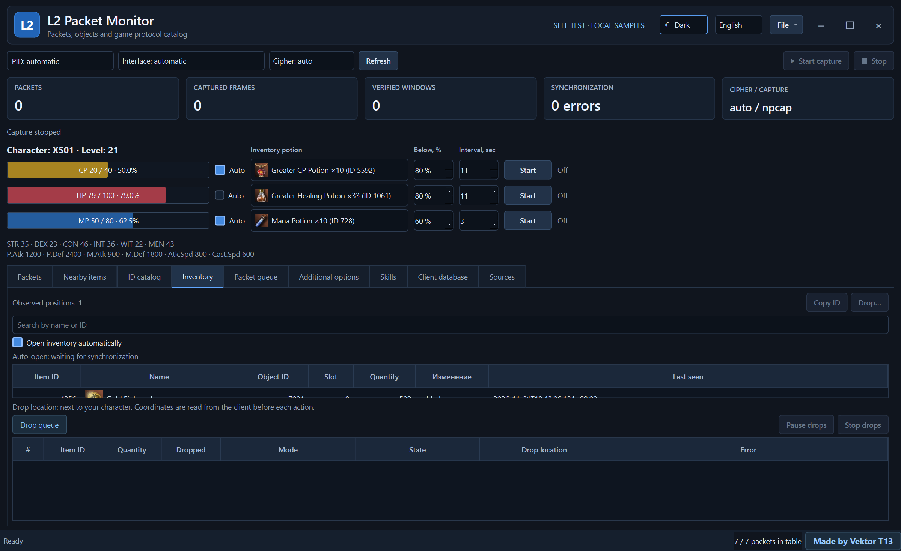
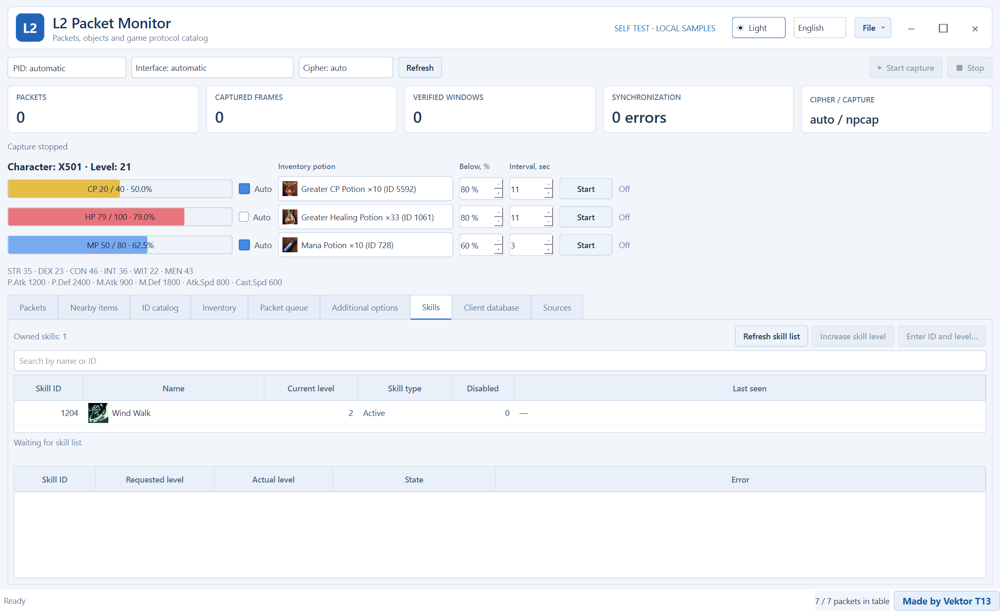
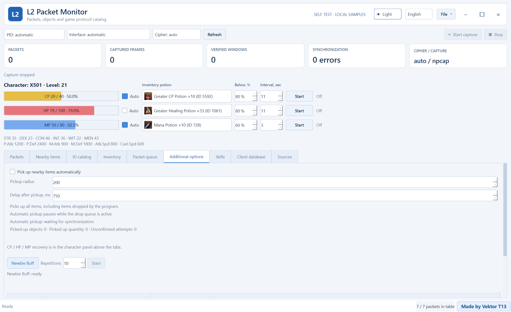
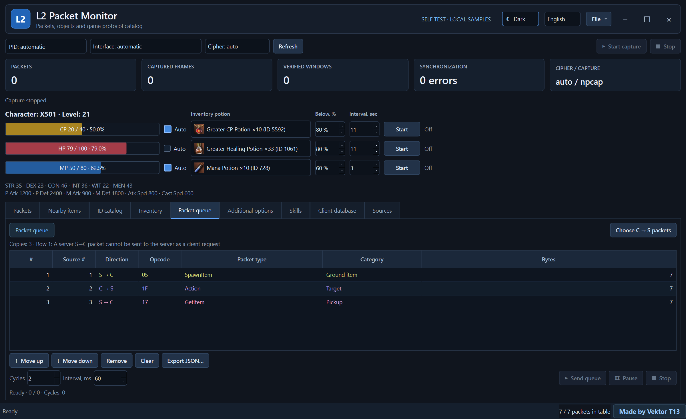
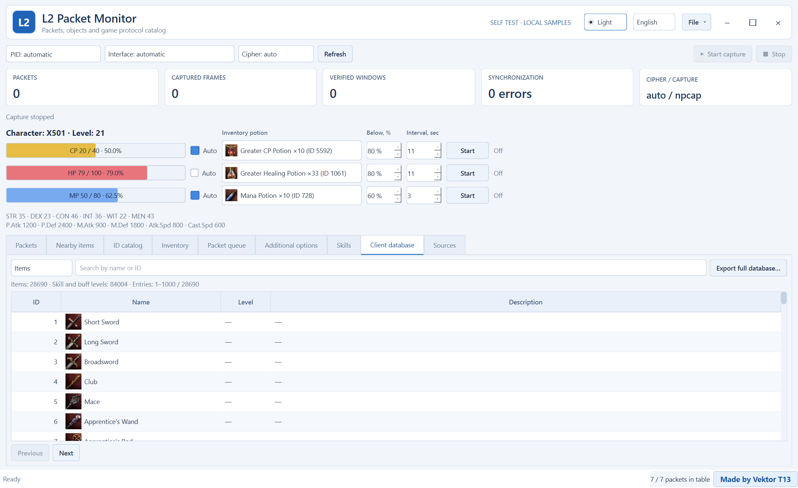

<p align="center"></p>

# L2 Packet Monitor — user guide

[Home](../../README.md) · **English** · [Русский](USER_GUIDE.ru.md) · [Download](https://github.com/vektort13/L2PacketMonitor/releases/latest)

## Contents

1. [Install and connect](#1-install-and-connect)
2. [Window and preferences](#2-window-and-preferences)
3. [Packet sources and profiles](#3-packet-sources-and-profiles)
4. [Inspect and filter packets](#4-inspect-and-filter-packets)
5. [HEX and text editor](#5-hex-and-text-editor)
6. [Inventory and item drops](#6-inventory-and-item-drops)
7. [Nearby items and automatic pickup](#7-nearby-items-and-automatic-pickup)
8. [Skills and learning](#8-skills-and-learning)
9. [CP, HP and MP recovery](#9-cp-hp-and-mp-recovery)
10. [Newbie Buff](#10-newbie-buff)
11. [Packet queue](#11-packet-queue)
12. [Client database and ID catalog](#12-client-database-and-id-catalog)
13. [Server bridge](#13-server-bridge)
14. [JSON API and command line](#14-json-api-and-command-line)
15. [Files and troubleshooting](#15-files-and-troubleshooting)

## 1. Install and connect

1. Open [Releases](https://github.com/vektort13/L2PacketMonitor/releases/latest). Download `L2PacketMonitor.exe`, or extract `L2PacketMonitor-v1.0.0-windows-x64.zip` into its own folder.
2. Install [Npcap](https://npcap.com/#download) for network capture if it is not already installed. The EXE runs without a separate Python, browser or Wireshark installation.
3. Double-click `L2PacketMonitor.exe`. Select **English** and your preferred theme in the top bar.
4. Launch the game and enter the world. Leave **PID: automatic**, **Interface: automatic** and **Cipher: auto** selected.
5. In **Sources**, keep **Auto: verified source** selected. Capture starts automatically when a suitable connection is found. If capture is stopped, click **Start capture**.
6. Check the process, connection, source and protocol in the status area. In **Packets**, game activity should produce new rows.

With multiple clients running, select the intended process and click **Refresh**. After restarting the game, use its current process. The server address and port are discovered from the connection.



## 2. Window and preferences

The top area contains theme/language controls, the **File** menu, process/interface/cipher selection and capture buttons. Below it are packet/frame/verification/synchronization counters and the character panel.

| Tab | Purpose |
|---|---|
| **Packets** | Filters, live exchange, decoded fields and packet copy editor |
| **Nearby items** | Observed ground items and coordinates |
| **ID catalog** | Item/skill observations grouped by server |
| **Inventory** | Full item list, search and drop context menu |
| **Packet queue** | Prepare and send sequences of C → S copies |
| **Additional options** | Automatic pickup and Newbie Buff |
| **Skills** | Learned skills, refresh and learning |
| **Client database** | Built-in items, skills and buffs |
| **Sources** | Capture modes, client profiles and server bridge |

Language, theme, filters and settings persist. Use **Stop** in the top bar to stop capture. Individual actions have their own stop controls in their tab or resource row.

## 3. Packet sources and profiles

Stop capture before changing the source. Select a mode in **Sources**, then start capture again.

| Mode | Behavior |
|---|---|
| **Auto: verified source** | Selects a supported client plaintext adapter, then the network profile |
| **Network capture** | Captures TCP through Npcap and applies the current build profile |
| **Client plaintext packets** | Receives C → S before encryption and S → C after decryption through the client adapter |
| **Server bridge** | Receives complete plaintext packets from the integrated server SDK |

For a build without a profile, network mode displays TCP data. The status shows whether decoding, replay and client actions are available. The saved `classic-h5` adapter matches Engine SHA-256 `557c9f6d…`; the `asterios-448` profile matches `f9632145…`. The table displays full hashes.

**Transfer profiles:** click **Export profiles…** and save a ZIP. On the other PC, stop capture and click **Import profiles…**. Imported profiles are added alongside the built-in profiles.



## 4. Inspect and filter packets

1. Open **Packets**. Enable categories and message types in the left panel. **All** enables them; **None** hides all rows.
2. Search for a packet name, opcode, object ID or decoded field value.
3. Choose both directions, **C → S** for client requests, or **S → C** for server responses.
4. Select a row. Its fields and HEX copy appear on the right. Row colors follow message categories such as movement, items, skills and pickup.
5. Turn off **Follow stream** while inspecting a section; turn it back on to follow new rows. **Reset filters** restores the general view.

Example: enable item categories, open the in-game inventory and look for `ItemList` / `InventoryUpdate`. Search for `SkillList` to inspect learned skills. Message names follow the active protocol.

Use the **File** menu to export captured data. Save an individual packet copy from the editor. The viewing buffer retains the most recent 10,000 packets.

## 5. HEX and text editor

1. Select a packet to load its copy into the editor on the right.
2. Edit bytes in **HEX**, or switch to **Text**.
3. Choose UTF-8, UTF-16LE, Windows-1251 or Latin-1.
4. Click **HEX → Text** or **Text → HEX**. `\xNN` represents one byte; `\\` represents a backslash.
5. After changing size, click **Fix u16 length** to update the leading two-byte length, including the header.
6. Choose **Save BIN…**, **Save JSON…**, or **Add copy to queue**. **Reset** restores the selected original.

Edits affect the copy. The queue uses the prepared version; the original captured record remains available.

## 6. Inventory and item drops

Open **Inventory** and wait for a complete `ItemList`. The table shows names, icons, item IDs, object IDs, quantities and slots. Search by name or ID.

**Open inventory automatically** helps obtain the full list. With the corresponding profile, the application opens the game's inventory using Alt+V; adapters with list requests use the client's normal list request. Once the full list is confirmed, reopening stops.

When the action is available, right-click an item:

- **Drop one item** — drop one unit.
- **Drop quantity…** — drop a specified quantity in one operation.
- **Drop one at a time…** — queue individual units.

Choose the quantity, mode and delay after the server response: **100–30,000 ms**. Add the action to the queue. Progress and coordinates appear below the table, with pause, resume and stop controls. Position is read before every action; drops are placed next to the character. Each step waits for the previous confirmation.



## 7. Nearby items and automatic pickup

**Nearby items** lists objects observed in the packet stream: IDs, quantity, coordinates, XY distance and spawn/pickup/removal events. Distance appears when the character's position is known.

To enable automatic pickup, open **Additional options**:

1. Set a **radius of 50–1500** and a **delay after pickup of 250–30,000 ms**.
2. Enable **Pick up nearby items automatically**.
3. Follow the status and confirmed pickup counters.

Pickup uses observed ground items, including items dropped by the application. It pauses while the drop queue is active. Clear the checkbox to disable it. Action availability follows the client profile.

## 8. Skills and learning

**Skills** shows learned skill IDs, current levels and types. The full list is requested after connection; use the refresh button to request it again.

Right-click a skill, choose **Increase skill level**, enter the target and confirm **OK**. **Enter skill ID and level…** accepts a manually entered ID and target level. For the profile using a server learning menu, search by name and use the options offered by that menu.

The application advances one level at a time and checks each step against the new server skill list. A refusal or missing confirmation stops the sequence at the last confirmed level. The result and history appear below the list.



## 9. CP, HP and MP recovery

The character panel above the tabs has three bars: **gold CP**, **red HP** and **blue MP**. Each has independent controls.

1. Wait for your character data and a complete inventory.
2. Select an inventory potion in the resource row. Its icon and remaining quantity appear beside the name.
3. Set a threshold of **1–99%** and an interval of **1–3600 seconds**.
4. Click **Start**. The **Auto** checkbox becomes selected and the status shows monitoring or recovery.
5. When the resource is **strictly below the threshold**, recovery continues toward **100%**. The server cooldown is respected in addition to the configured interval.
6. Click **Stop** in that row, or clear its **Auto** checkbox.

Example: select Greater Healing Potion for HP, choose **80%**, set **11 seconds**, and click Start. At HP 79%, recovery begins and continues until full.

The three channels operate independently. Stop preserves their settings. After restarting the application, all channels are stopped; start the ones you need. Sending pauses on death, incomplete data, capture gaps or a missing consumable. Queues and other active actions also pause recovery.

If the name or values show **“—”**, the program is waiting for your full `UserInfo`. The next full update or entry into the world links subsequent resource updates to your character.

## 10. Newbie Buff

In **Additional options**, find **Newbie Buff**, choose **1–1000 repeats** and click **Start**. With the corresponding profile, the program uses the verified Newbie Guide menu and sends the request series.

The panel shows requests sent, server-confirmed buff sets and remaining effect time. Sent requests and confirmed sets have separate counters. In a smaller window, scroll down to reach this block.



## 11. Packet queue

1. In **Packets**, select an outgoing **C → S** packet. Add a copy using the context menu or editor button.
2. Open **Packet queue**. **Select C → S packets** returns you to outgoing packets.
3. Use **Up**, **Down**, **Remove** and **Clear** to prepare the sequence.
4. Set **1–10,000 cycles** and an **interval of 0–60,000 ms**. The interval starts after the previous packet is confirmed in capture.
5. When a sender is available, click **Send queue**. Follow the packet number, cycle and result; use **Pause**, **Resume** and **Stop** as needed.
6. **Export JSON…** saves the prepared list.

Example: add two observed C → S copies, set **3 cycles** and **500 ms**. The application performs six sequential sends. New outgoing bytes confirm transmission; game results are visible in server responses.

S → C packets and raw TCP fragments are not queued for replay. The interface shows sender availability and the reason for waiting.



## 12. Client database and ID catalog

**Client database** works without the game. Choose **Items** or **Skills and buffs**, search by name/ID and browse pages. **Export full database…** saves JSON. The bundled catalog contains 28,690 items and 84,004 skill/buff level records.

**ID catalog** accumulates observations from captured exchange. Choose items/skills, server and search. JSON/CSV export supports comparisons. Observations are separated by server/profile and persist across restarts.



## 13. Server bridge

1. Stop capture and select **Server bridge** in **Sources**.
2. Start capture. Check the bridge status; use **Start bridge** if needed.
3. Click **Export server module…**. The ZIP contains Java/Python SDK files and the current `bridge.json` configuration.
4. Integrate the SDK into your server: submit complete C → S after decryption and S → C before encryption, including the two-byte length header.
5. Create a separate SDK session for each game connection. Monitor received/dropped counts in the application.

Use a tunnel to the local receiver for a remote server. Export fresh configuration after restarting the receiver. See the [English SDK guide](../SERVER_BRIDGE.en.md) and [Russian SDK instructions](../../src/server_bridge_sdk/README.md) for Java/Python examples.

## 14. JSON API and command line

The API is off by default. Enable it with:

```powershell
.\L2PacketMonitor.exe --api --port 8765
```

Read examples:

```powershell
Invoke-RestMethod http://127.0.0.1:8765/api/status
Invoke-RestMethod http://127.0.0.1:8765/api/inventory
Invoke-RestMethod http://127.0.0.1:8765/api/recovery
Invoke-RestMethod http://127.0.0.1:8765/api/sources
```

POST calls use the `X-Monitor-Token` header returned by `GET /api/info`. Packet copy conversion example:

```powershell
$base = 'http://127.0.0.1:8765'
$info = Invoke-RestMethod "$base/api/info"
$headers = @{ 'X-Monitor-Token' = $info.token }
$body = @{ mode = 'hex-to-text'; encoding = 'utf-8'; hex = '4C 32' } | ConvertTo-Json
Invoke-RestMethod "$base/api/convert" -Method Post -Headers $headers -ContentType 'application/json' -Body $body
```

| Flag | Purpose |
|---|---|
| `--pid <number>` | Select the current game process |
| `--interface auto` | Select the adapter automatically |
| `--source auto\|network\|client\|server` | Packet source |
| `--cipher auto\|asterios\|l2xor16\|l2xor16-u64\|plain` | Cipher mode |
| `--interval 4` | Network interval, 2–30 seconds |
| `--no-autostart` | Open without automatic capture |
| `--api --port 8765` | Enable the loopback API |
| `--self-test --no-api --self-test-output <folder>` | Test UI and bundled modules using test data |

See the [API reference](../API.md) for current routes.

## 15. Files and troubleshooting

The packaged EXE stores captures, the SQLite catalog, copies and imported profiles under `%LOCALAPPDATA%\L2PacketMonitor`. Qt stores interface preferences in `HKEY_CURRENT_USER\Software\AsteriosTools\L2PacketMonitor`. Source runs store working data inside the project folder.

| Symptom | Action |
|---|---|
| Waiting for game client | Enter the world, click Refresh and select the current process |
| Several TCP connections | Select the intended process and check its game-server connection |
| No Npcap interfaces | Install Npcap; use loopback for a local server; check the driver access mode chosen during installation |
| Only TCP data appears | Inspect the build fingerprint in Sources; use a matching profile or server SDK |
| Client mode waits for an adapter | Choose Auto/network, or install a profile with an adapter for this build |
| Inventory incomplete | Wait for ItemList; enable automatic opening or open the inventory in the game |
| Character/resources show “—” | Wait for full UserInfo; re-enter the world if needed |
| Action button unavailable | Read source/sender status and check full lists and the current build profile |
| Potion not used | Check the item, Start state, below-threshold value, remaining quantity and cooldown |
| Newbie Buff block out of view | Scroll Additional options |
| Decoding stops after a client update | Compare Engine.dll fingerprint with the saved profile |

[Build from source](../BUILD.en.md) · [All screenshots](../GALLERY.md) · [Resources](../RESOURCES.md)

**Made by Vektor T13**
