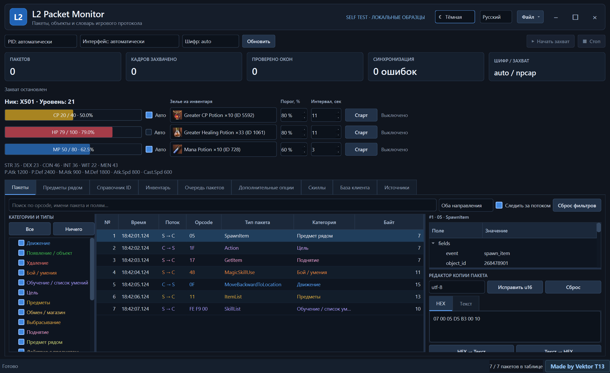
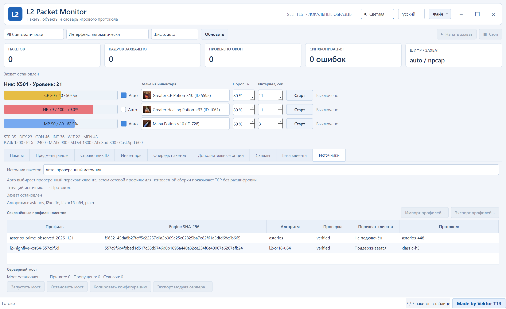
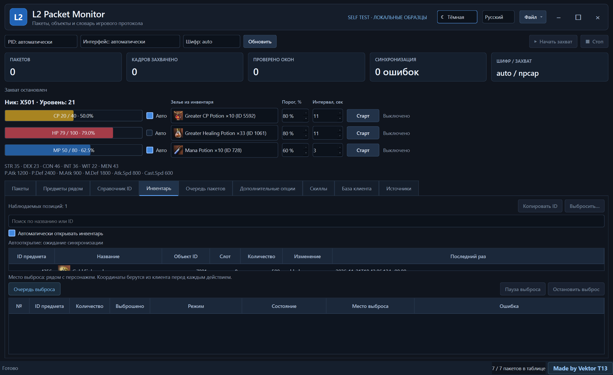
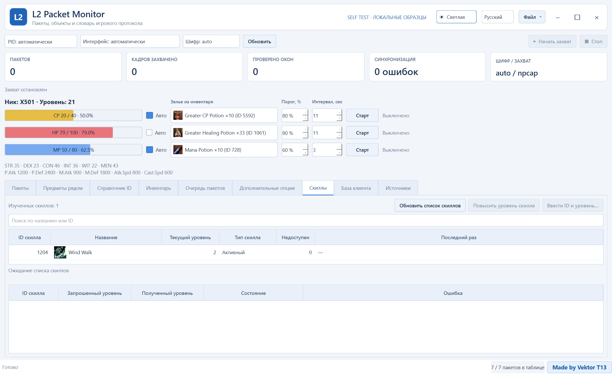
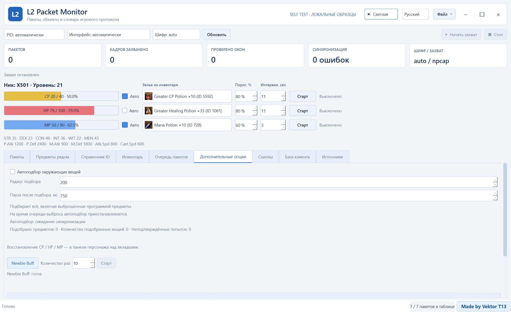
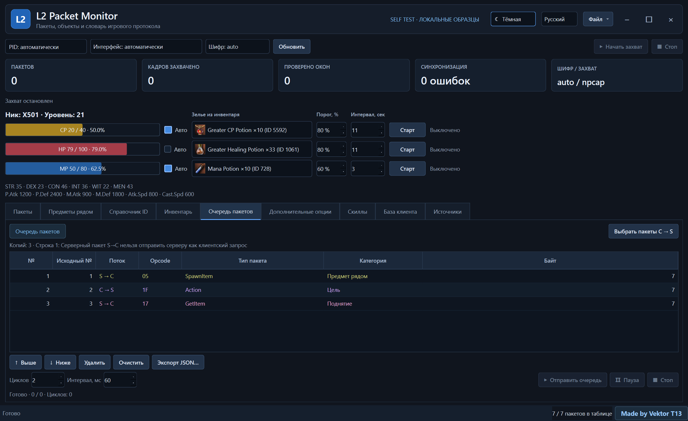
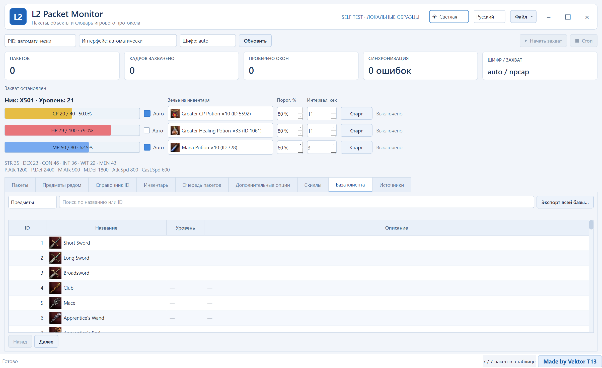

<p align="center"></p>

# L2 Packet Monitor — руководство пользователя

[Главная](../../README.ru.md) · **Русский** · [English](USER_GUIDE.en.md) · [Скачать](https://github.com/vektort13/L2PacketMonitor/releases/latest)

## Содержание

1. [Установка и первое подключение](#1-установка-и-первое-подключение)
2. [Окно программы и настройки](#2-окно-программы-и-настройки)
3. [Источники пакетов и профили](#3-источники-пакетов-и-профили)
4. [Просмотр и фильтрация пакетов](#4-просмотр-и-фильтрация-пакетов)
5. [Редактор HEX и текста](#5-редактор-hex-и-текста)
6. [Инвентарь и выброс предметов](#6-инвентарь-и-выброс-предметов)
7. [Предметы рядом и автоподбор](#7-предметы-рядом-и-автоподбор)
8. [Скиллы и обучение](#8-скиллы-и-обучение)
9. [Восстановление CP, HP и MP](#9-восстановление-cp-hp-и-mp)
10. [Newbie Buff](#10-newbie-buff)
11. [Очередь пакетов](#11-очередь-пакетов)
12. [База клиента и справочник ID](#12-база-клиента-и-справочник-id)
13. [Серверный мост](#13-серверный-мост)
14. [JSON API и параметры запуска](#14-json-api-и-параметры-запуска)
15. [Файлы и решение проблем](#15-файлы-и-решение-проблем)

## 1. Установка и первое подключение

1. Откройте [Releases](https://github.com/vektort13/L2PacketMonitor/releases/latest). Скачайте `L2PacketMonitor.exe` либо ZIP `L2PacketMonitor-v1.0.0-windows-x64.zip` и распакуйте его в отдельную папку.
2. Для сетевого захвата установите [Npcap](https://npcap.com/#download). Если драйвер уже установлен, используйте его. Python, браузер и Wireshark для запуска EXE не требуются.
3. Запустите `L2PacketMonitor.exe` двойным щелчком. Выберите **«Русский»** и удобную тему в верхней панели.
4. Запустите игровой клиент и войдите в мир. Оставьте **PID: автоматически**, **Интерфейс: автоматически**, **Шифр: auto**.
5. На вкладке **«Источники»** оставьте **«Авто: проверенный источник»**. Захват запускается автоматически при обнаружении подходящего соединения; при остановленном захвате нажмите **«Начать захват»**.
6. Проверьте строку состояния: выбранный процесс, соединение, источник и протокол. В таблице «Пакеты» должны появляться строки при игровых действиях.

Если запущено несколько клиентов, выберите нужный в поле PID и нажмите **«Обновить»**. При новом запуске игры выберите её текущий процесс. Адрес сервера и порт программа определяет по соединению.



## 2. Окно программы и настройки

Сверху находятся тема, язык, меню **«Файл»**, выбор процесса/интерфейса/шифра и кнопки захвата. Ниже — счётчики пакетов, кадров, проверенных окон и ошибок синхронизации, затем панель персонажа.

| Вкладка | Для чего нужна |
|---|---|
| **Пакеты** | Фильтры, таблица обмена, разобранные поля, редактор копии |
| **Предметы рядом** | Наблюдаемые предметы на земле и их координаты |
| **Справочник ID** | Накопленные наблюдения предметов и скиллов по серверу |
| **Инвентарь** | Полный список предметов, поиск, меню выброса |
| **Очередь пакетов** | Подготовка и отправка последовательностей C → S |
| **Дополнительные опции** | Автоподбор и Newbie Buff |
| **Скиллы** | Изученные умения, обновление, обучение |
| **База клиента** | Встроенная база предметов, скиллов и бафов |
| **Источники** | Режим захвата, профили и серверный мост |

Язык, тема, фильтры и настройки сохраняются. Для остановки захвата используйте **«Стоп»** в верхней панели. Кнопки остановки конкретного действия расположены в соответствующей вкладке или строке ресурса.

## 3. Источники пакетов и профили

Остановите захват перед сменой источника, выберите режим на вкладке **«Источники»**, затем запустите захват снова.

| Режим | Поведение |
|---|---|
| **Авто: проверенный источник** | Выбирает адаптер открытых пакетов проверенной сборки, затем сетевой профиль |
| **Сетевой захват** | Захватывает TCP через Npcap и применяет профиль текущей сборки |
| **Открытые пакеты клиента** | Получает C → S до шифрования и S → C после расшифровки через адаптер клиента |
| **Серверный мост** | Принимает полные открытые пакеты от подключённого серверного SDK |

Для сборки без профиля сетевой режим показывает TCP-данные. Доступность расшифровки, очереди и клиентских действий отображается в статусах. Адаптер `classic-h5` сохранён для Engine SHA-256 `557c9f6d…`, профиль `asterios-448` — для `f9632145…`; полные хеши видны в таблице.

**Перенос профилей:** нажмите **«Экспорт профилей…»**, сохраните ZIP. На другом ПК остановите захват и нажмите **«Импорт профилей…»**. Встроенные профили сохраняются; импортируемые профили добавляются к ним.



## 4. Просмотр и фильтрация пакетов

1. Откройте **«Пакеты»**. В левой панели включите категории и нужные типы сообщений. **«Все»** включает их, **«Ни одного»** скрывает все строки.
2. В поле поиска введите имя пакета, opcode, ID объекта или значение разобранного поля.
3. Выберите направление: оба, **C → S** — от клиента к серверу, **S → C** — от сервера к клиенту.
4. Нажмите строку. Справа откроются её поля и HEX-копия. Цвет строки соответствует смыслу сообщения: движение, предметы, скиллы, подбор и другие категории.
5. Отключите **«Следить за потоком»**, чтобы спокойно изучить выбранный участок. Для возврата включите его снова. **«Сбросить фильтры»** возвращает общий просмотр.

Пример: включите категорию предметов, откройте инвентарь в игре и найдите `ItemList` / `InventoryUpdate`. Для умений ищите `SkillList`. Названия сообщений зависят от выбранного протокола.

Для сохранения данных используйте экспорт в меню **«Файл»**. Отдельную копию пакета можно сохранить через редактор. Буфер просмотра содержит последние 10 000 пакетов.

## 5. Редактор HEX и текста

1. Выберите пакет. Его копия появится справа в редакторе.
2. Правьте байты на вкладке **HEX** либо текст на вкладке **«Текст»**.
3. Выберите кодировку: UTF-8, UTF-16LE, Windows-1251 или Latin-1.
4. Нажмите **HEX → Текст** или **Текст → HEX**. Последовательность `\xNN` задаёт отдельный байт, `\\` — обратную косую черту.
5. После изменения размера нажмите **«Исправить u16»**, чтобы обновить двухбайтовую длину пакета в начале. Длина включает заголовок.
6. Используйте **«Сохранить BIN…»**, **«Сохранить JSON…»** либо **«Добавить копию в очередь»**. **«Сброс»** возвращает выбранный оригинал.

Изменения относятся к копии. При добавлении в очередь отправляется подготовленная версия; исходная запись захвата сохраняется.

## 6. Инвентарь и выброс предметов

Откройте **«Инвентарь»** и дождитесь полного `ItemList`. В таблице видны названия, иконки, Item ID, Object ID, количество и слот. Поиск работает по названию и ID.

Настройка **«Автоматически открывать инвентарь»** помогает получить полный список. Для соответствующего профиля программа открывает окно инвентаря игры через Alt+V; адаптер с запросами списков получает список штатным запросом клиента. После подтверждения полного списка повторное открытие прекращается.

При доступном действии нажмите предмет правой кнопкой:

- **«Выбросить одну штуку»** — одна единица.
- **«Выбросить количество…»** — заданное количество одной операцией.
- **«Выбрасывать по одной…»** — очередь отдельных единиц.

В диалоге выберите количество, режим и паузу после ответа сервера: **100–30 000 мс**. Затем добавьте действие в очередь. Прогресс и координаты показаны под таблицей; доступны пауза, продолжение и остановка. Перед каждым действием позиция читается заново; место выброса находится рядом с персонажем. Следующая операция ждёт подтверждения предыдущей.



## 7. Предметы рядом и автоподбор

Во вкладке **«Предметы рядом»** видны предметы, поступившие в наблюдаемых сообщениях: ID, количество, координаты, расстояние XY и событие появления/подбора/удаления. Расстояние появляется при известной позиции персонажа.

Для автоматического подбора откройте **«Дополнительные опции»**:

1. Задайте **радиус 50–1500** и **паузу после подбора 250–30 000 мс**.
2. Включите **«Автоподбор окружающих вещей»**.
3. Следите за статусом и счётчиками подтверждённых подборов.

Подбор использует предметы из наблюдаемого обмена, включая выброшенные программой. На время очереди выброса он приостанавливается. Для отключения снимите галочку. Доступность действия зависит от клиентского профиля.

## 8. Скиллы и обучение

Во вкладке **«Скиллы»** отображаются изученные умения с ID, текущим уровнем и типом. Полный список запрашивается после подключения; кнопка обновления получает его заново.

Чтобы повысить уровень, нажмите скилл правой кнопкой и выберите **«Повысить уровень скилла»**, задайте целевой уровень и подтвердите **OK**. Кнопка **«Ввести ID и уровень…»** позволяет указать ID и уровень вручную. Для профиля с серверным меню используйте поиск по названию и предлагаемые меню варианты.

Программа проходит уровни последовательно. Результат каждого шага проверяется по новому серверному списку. Если сервер отказывает или подтверждение не поступает, обучение останавливается на последнем подтверждённом уровне. Результат и история отображаются внизу вкладки.



## 9. Восстановление CP, HP и MP

Над вкладками расположены три полосы: **CP — жёлтая**, **HP — красная**, **MP — синяя**. Для каждой есть собственные настройки.

1. Дождитесь данных собственного персонажа и полного инвентаря.
2. В строке нужного ресурса выберите зелье из инвентаря. Рядом с названием показаны иконка и остаток.
3. Установите порог **1–99%** и интервал **1–3600 секунд**.
4. Нажмите **«Старт»**. Галочка **«Авто»** включится; статус покажет наблюдение или восстановление.
5. Когда значение становится **строго ниже порога**, канал восстанавливает ресурс до **100%**. Фактический серверный откат учитывается дополнительно к интервалу.
6. Для остановки нажмите **«Стоп»** в этой строке либо снимите её галочку **«Авто»**.

Пример: для HP выберите Greater Healing Potion, порог **80%**, интервал **11 секунд** и нажмите «Старт». При HP 79% восстановление начинается и продолжается до полного значения.

Три канала работают независимо. Кнопка «Стоп» сохраняет выбранные параметры. После перезапуска программы все каналы остановлены — запустите нужные снова. При смерти, неполных данных, разрыве захвата и отсутствии расходника отправка приостанавливается. Очереди и другие активные действия также приостанавливают восстановление.

Если вместо имени/значений показано **«—»**, программа ждёт полный `UserInfo` собственного персонажа. Следующий полный пакет или вход в мир позволяет связать дальнейшие обновления с ним.

## 10. Newbie Buff

Откройте **«Дополнительные опции»**, найдите блок **Newbie Buff**, задайте **1–1000 повторов** и нажмите **«Старт»**. Для соответствующего профиля программа использует проверенное меню Newbie Guide и отправляет серию запросов.

В блоке показаны отправленные запросы, подтверждённые сервером наборы и оставшееся время эффектов. Число отправленных запросов и число подтверждённых наборов показаны отдельно. В небольшом окне прокрутите вкладку вниз до блока.



## 11. Очередь пакетов

1. На вкладке **«Пакеты»** выберите исходящий **C → S** пакет. Добавьте его копию через контекстное меню или кнопку редактора.
2. Перейдите в **«Очередь пакетов»**. Кнопка **«Выбрать пакеты C → S»** помогает вернуться к исходящим пакетам.
3. Кнопками **«Выше»**, **«Ниже»**, **«Удалить»**, **«Очистить»** подготовьте последовательность.
4. Укажите **1–10 000 циклов** и **интервал 0–60 000 мс**. Интервал — пауза после подтверждения предыдущего пакета в захвате.
5. При доступном отправителе нажмите **«Отправить очередь»**. Следите за номером пакета, циклом и результатом. Используйте **«Пауза»**, **«Продолжить»** и **«Стоп»** по необходимости.
6. **«Экспорт JSON…»** сохраняет подготовленный список.

Пример: добавьте две наблюдавшиеся копии C → S, задайте **3 цикла** и **500 мс**. Программа последовательно выполнит шесть отправок. Подтверждение новых исходящих байтов показывает факт отправки; игровые результаты видны по ответам сервера.

Серверные пакеты S → C и необработанные TCP-фрагменты для отправки через очередь не используются. Доступность отправителя и причина ожидания показаны в интерфейсе.



## 12. База клиента и справочник ID

**«База клиента»** доступна без запущенной игры. Выберите **«Предметы»** или **«Скиллы и бафы»**, введите название/ID, перелистывайте страницы. Кнопка **«Экспорт всей базы…»** сохраняет JSON. Встроены 28 690 предметов и 84 004 записи умений/бафов по уровням.

**«Справочник ID»** накапливает наблюдения из обмена. Выберите предметы/скиллы, сервер и поиск. Экспорт JSON/CSV позволяет сравнивать записи. Наблюдения разделены по серверу и профилю; справочник сохраняется между запусками.



## 13. Серверный мост

1. Остановите захват и выберите **«Серверный мост»** на вкладке **«Источники»**.
2. Запустите захват. Проверьте состояние моста; при необходимости используйте **«Запустить мост»**.
3. Нажмите **«Экспорт модуля сервера…»**. ZIP содержит Java/Python SDK и текущую конфигурацию `bridge.json`.
4. Подключите SDK в коде своего сервера: передавайте полные C → S после расшифровки и S → C перед шифрованием, включая двухбайтовую длину.
5. Создавайте отдельный SDK-сеанс для каждого игрового соединения. Следите за числом принятых и пропущенных пакетов в программе.

Для удалённого сервера используется туннель к локальному приёмнику. После перезапуска приёмника экспортируйте актуальную конфигурацию. Подробные примеры Java/Python: [руководство SDK](../SERVER_BRIDGE.en.md), [исходная инструкция на русском](../../src/server_bridge_sdk/README.md).

## 14. JSON API и параметры запуска

По умолчанию API выключен. Чтобы включить его, запустите:

```powershell
.\L2PacketMonitor.exe --api --port 8765
```

Примеры чтения:

```powershell
Invoke-RestMethod http://127.0.0.1:8765/api/status
Invoke-RestMethod http://127.0.0.1:8765/api/inventory
Invoke-RestMethod http://127.0.0.1:8765/api/recovery
Invoke-RestMethod http://127.0.0.1:8765/api/sources
```

POST требует заголовок `X-Monitor-Token` из `GET /api/info`. Пример преобразования копии:

```powershell
$base = 'http://127.0.0.1:8765'
$info = Invoke-RestMethod "$base/api/info"
$headers = @{ 'X-Monitor-Token' = $info.token }
$body = @{ mode = 'hex-to-text'; encoding = 'utf-8'; hex = '4C 32' } | ConvertTo-Json
Invoke-RestMethod "$base/api/convert" -Method Post -Headers $headers -ContentType 'application/json' -Body $body
```

| Параметр | Назначение |
|---|---|
| `--pid <число>` | Выбор текущего игрового процесса |
| `--interface auto` | Автовыбор адаптера |
| `--source auto\|network\|client\|server` | Источник пакетов |
| `--cipher auto\|asterios\|l2xor16\|l2xor16-u64\|plain` | Режим шифра |
| `--interval 4` | Интервал сети, 2–30 секунд |
| `--no-autostart` | Открыть окно без автоматического захвата |
| `--api --port 8765` | Включить локальный API |
| `--self-test --no-api --self-test-output <папка>` | Проверить интерфейс и встроенные модули на тестовых данных |

Полный справочник актуальных маршрутов: [API](../API.md).

## 15. Файлы и решение проблем

У готового EXE данные хранятся в `%LOCALAPPDATA%\L2PacketMonitor`: журнал захвата, SQLite-справочник, копии и импортированные профили. Настройки интерфейса сохраняются через Qt в `HKEY_CURRENT_USER\Software\AsteriosTools\L2PacketMonitor`. При запуске из исходников рабочие данные находятся в папке проекта.

| Что видно | Что сделать |
|---|---|
| Ожидание игрового клиента | Войдите в мир, нажмите «Обновить», выберите текущий процесс |
| Несколько TCP-соединений | Выберите нужный процесс; проверьте, что игра подключена к игровому серверу |
| Не найдены интерфейсы Npcap | Установите Npcap; для локального сервера нужен loopback; учитывайте выбранный при установке режим доступа к драйверу |
| Доступны только TCP-данные | Посмотрите SHA-256 и профиль на вкладке «Источники»; используйте подходящий профиль или серверный SDK |
| В режиме «Клиент» ожидание адаптера | Выберите Auto/сеть либо подключите профиль с адаптером именно этой сборки |
| Инвентарь неполный | Дождитесь ItemList; включите автооткрытие или откройте инвентарь в игре |
| Персонаж и ресурсы «—» | Дождитесь полного UserInfo; при необходимости повторно войдите в мир |
| Кнопка действия недоступна | Прочитайте статус источника/отправителя, проверьте полный список и профиль текущей сборки |
| Зелья не применяются | Проверьте выбранный предмет, «Старт», значение ниже порога, остаток и серверный откат |
| Блок Newbie Buff не помещается | Прокрутите вкладку «Дополнительные опции» |
| После обновления клиента нет расшифровки | Сравните отпечаток Engine.dll с сохранённым профилем |

[Сборка из исходников](../BUILD.ru.md) · [Все скриншоты](../GALLERY.md) · [Ресурсы](../RESOURCES.md)

**Made by Vektor T13**
