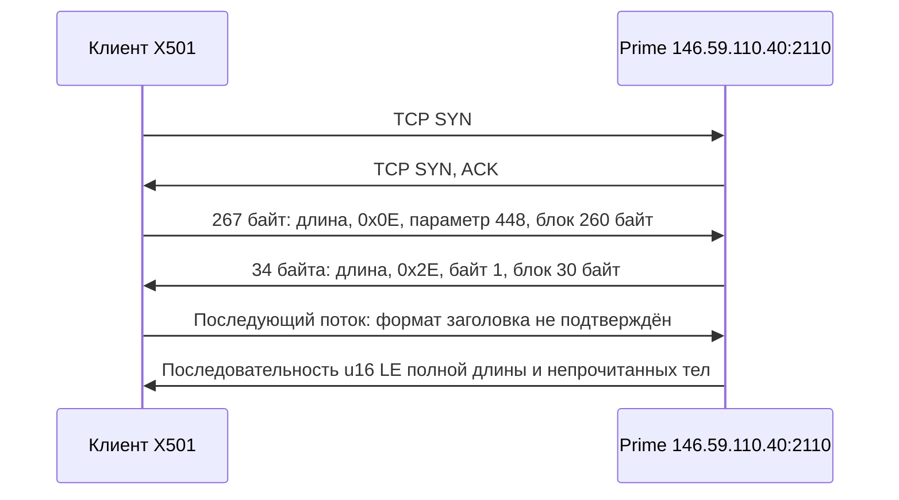

# Структура сетевого общения: проверка через REA

Дата: 2026-11-21, Asia/Dubai. Использован навык `reverse-engineer-anything`, сервер REA 6.8.0. Проверены поставленные PE-файлы и ранее записанный трафик персонажа X501 на Prime.

Результат: установлен внешний формат серверного потока и найдены экспортные имена клиентских сетевых компонентов и обработчиков событий. Раскладка игровых полей, соответствие opcode обработчикам и фактическая схема шифрования пока не установлены.

## Обмен на проводе

Основание: `prime-relogin.pcapng`, SHA-256 `8c9a3c7fde74067f4c9d638b3603ebdcad568148d3ac10e53b90f9ceffc80582`. [Предыдущий отчёт](packet-analysis.md) содержит условия захвата. Повторная запись сетевого обмена на этом этапе не выполнялась.

Наблюдаемый транспорт: Ethernet → PPPoE → PPP → IPv4 → TCP. В записи новое соединение идёт от локального порта 26087 к `146.59.110.40:2110`. Начало TCP-соединения сохранено.

На схеме показаны прикладные сообщения после сборки TCP, а не границы отдельных TCP-сегментов. Интерпретации `ProtocolVersion` и `KeyPacket` остаются сопоставлением с открытым образцом из [предыдущего отчёта](packet-analysis.md).

### Первое клиентское сообщение, кадр 4

Смещения даны от начала прикладного сообщения и включают заголовок длины.

| Смещение | Размер | Наблюдение | Интерпретация |
|---:|---:|---|---|
| 0 | 2 | `0b 01` = 267, u16 LE | Полная длина, включая эти два байта |
| 2 | 1 | `0e` | Начальный код сообщения |
| 3 | 4 | `c0 01 00 00` = 448, u32 LE | Кандидат заявленной версии протокола |
| 7 | 260 | Непрочитанный блок | Назначение полей не установлено |

Число 448 не является доказательством Interlude C6 или конкретных хроник Asterios.

### Первое серверное сообщение, кадр 6

| Смещение | Размер | Наблюдение | Интерпретация |
|---:|---:|---|---|
| 0 | 2 | `22 00` = 34, u16 LE | Полная длина |
| 2 | 1 | `2e` | Начальный код сообщения |
| 3 | 1 | `01` | Кандидат результата/флага |
| 4 | 16 | Непрочитанный блок A | Ранее проверялся как кандидат ключа; не валидирован |
| 20 | 14 | Непрочитанный блок B | Границы конкретных полей не установлены |

Разделение последних 30 байт на 16 и 14 фиксирует проверенную ранее гипотезу, а не доказанную раскладку серверного KeyPacket. Значения блока A в текстовый отчёт не перенесены.

### Последующий серверный поток

После сборки получено **39 336 байт server→client**, полностью покрываемых **1236 сообщениями** вида `[u16 LE полная длина][тело]`. Первые длины: 34, 151, 59, 130. Идентификация тела второго и последующих сообщений отсутствует.

Поток client→server содержит **3169 байт**. Гипотеза такой же длины объясняет начальные 267 байт, но не даёт согласованного разбора остатка с выбранной позиции. Нельзя автоматически применять один формат к обоим направлениям.

В захваченных диапазонах не обнаружены дырки или конфликтующие перекрытия. server-message-index.csv (`reports/rea-network-20261121/server-message-index.csv`) содержит номер сообщения, смещение, длину и номера исходных TCP-кадров. wire-structure.json (`reports/rea-network-20261121/wire-structure.json`) фиксирует параметры разбора и хеш записи. Эти артефакты созданы обычным локальным TShark/Python, отдельно от REA Evidence.

## Статические факты из REA

`inspect_pe_imports` подтвердил PE32/x86 для `AsteriosGame.exe`, `Engine.dll` и `IpDrv.dll`. `inspect_native_exports` прочитал экспортные таблицы, а `inspect_with_objdump(section_headers)` — секции Engine.dll. Полный пакет Evidence (`reports/rea-network-20261121/evidence.json`) содержит 10 записей, идентичность файлов, диапазоны таблиц и ограничения наблюдений.

| Файл | Наблюдение |
|---|---|
| AsteriosGame.exe | 138 импортов; Engine.dll и Core.dll импортируются по ordinal 1 |
| Engine.dll | 0 записей обычной таблицы импортов; 12 998 экспортов |
| IpDrv.dll | 592 импорта; среди них 25 функций WSOCK32.dll по ordinal; 413 экспортов |
| SysWOW64/wsock32.dll | Экспорты использованы для сопоставления ordinal с именами Winsock |

Отсутствие обычных импортов у Engine.dll не означает отсутствие сетевых вызовов. Таблицы не показывают динамическое разрешение адресов и не доказывают, что конкретный экспорт вызывается при данном подключении.

### Компоненты и обработчики в Engine.dll

Ниже — имена и предпочтительные VA из экспортной таблицы файла. Это не измеренные адреса в работающем процессе и не доказанный граф вызовов.

| Экспортное имя или часть имени | VA файла | Что установлено |
|---|---|---|
| autoclassCAuthSocket | 0x20ae6b04 | Экспортированное имя данных, указывающее на класс с таким названием |
| autoclassCClientSocket | 0x20ae6b00 | Экспортированное имя данных |
| autoclassUNetworkHandler | 0x20ae6b0c | Экспортированное имя данных |
| DispatchSocketWindowMsg | 0x206503d0 | Именованный экспорт функции |
| UGameEngine::RequestEnterWorld | 0x20493b10 | Именованный экспорт функции |
| UGameEngine::OnUserInfo | 0x20592f20 | Именованный экспорт функции |
| UGameEngine::OnCharInfo | 0x2059b110 | Именованный экспорт функции |
| UGameEngine::OnDeleteUser | 0x20591b00 | Именованный экспорт функции |
| UGameEngine::OnTeleportToLocation | 0x2059a250 | Именованный экспорт функции |

Источник таблицы: `ev_9e12a345a4e0ee1c30c6825532ece16e24d2609b7b6ffc59b78bcc7292f8fc8c`. Полные декорированные имена и ordinal: selected-native-facts.json (`reports/rea-network-20261121/selected-native-facts.json`).

Рабочая гипотеза архитектуры — сокетный компонент, обработчик сетевых сообщений и методы UGameEngine, обновляющие игровые объекты. Экспортные имена поддерживают выбор этих точек для исследования, однако порядок вызовов, структура очередей и привязка к opcode не восстановлены. `OnDeleteUser` нельзя автоматически считать точным обработчиком конкретного сетевого DeleteObject.

### IpDrv и Winsock

В импортах IpDrv есть ссылки на `UNetConnection::ReceivedRawPacket`, `ReadInput`, `UNetDriver::TickDispatch`, `TickFlush` и другие классы Unreal. В экспортах присутствуют `UTcpipConnection::LowLevelSend` и `UTcpNetDriver::InitConnect`. Это отдельные статические признаки общего сетевого слоя Unreal; их участие в игровом TCP-потоке Asterios не доказано.

Импорты IpDrv ordinal 4, 16, 19, 23 соответствуют `connect`, `recv`, `send`, `socket` в проверенной 32-битной системной WSOCK32.dll. Для части функций таблица содержит forwarder в WS2_32. Основания: `ev_892786898bae1ecc28e48ef6c7564827d6d610d5c4b113ad2b9643bf00ab4cbc` и `ev_09098e5715bb5f53f6f5063ef4f34d6b773ff75ea6dc022e62462d871381ec32`. Фактическая привязка импортов при исполнении не наблюдалась.

## Граница выполненного анализа

Engine.dll имеет секции с пустым именем, `ddvftmnc`, `rzlgewek` и `.rsrc`; обычная таблица импортов пуста. Это нетипичный для прямого анализа образ. Эти признаки не устанавливают конкретный упаковщик или защиту.

Поиск строк через Ghidra 12.1.4 не дал используемого результата за время ожидания. Оркестрация запроса остановлена; затем REA успешно закрыла активную сессию. rea-close-state.json (`reports/rea-network-20261121/rea-close-state.json`) фиксирует результат проверки состояния. Ни псевдокод, ни граф вызовов по этой попытке не получены. Файлы клиента не изменялись.

Обычное перечисление выбранных модулей процесса вернуло пустой список. Поэтому привязка экспортов к загруженным модулям не подтверждена. Само TCP-соединение процесса наблюдалось: runtime-network-snapshot.json (`reports/rea-network-20261121/runtime-network-snapshot.json`). Снимок получен PowerShell, не средствами REA.

## Что теперь можно исследовать воспроизводимо

1. Сопоставлять длины и время сообщений с независимыми наблюдениями интерфейса, используя индекс кадров.
2. На собственном сервере сопоставить сообщения до шифрования с записанным TCP и подтвердить раскладку полей для выбранного протокола.
3. Проверять участие найденных обработчиков только по дополнительным статическим ссылкам или разрешённым наблюдениям, сохраняя различие между наличием имени и фактическим исполнением.

Расшифровка Asterios по-прежнему не подтверждена. Найденные имена и формат длины сами по себе не восстанавливают Object ID, координаты, KnownList или состояние видимости.
